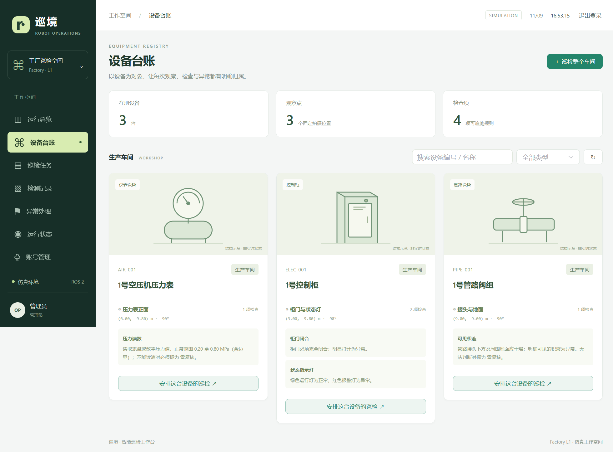
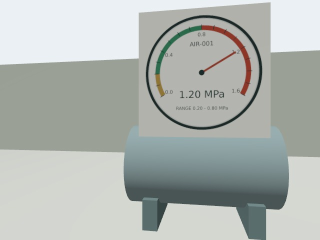

# 巡境 · 机器人设备巡检工作台

面向工厂设备巡检的单机器人上层应用项目，将设备台账、任务执行、现场图像、异常处理与设备复检串成可追溯的业务流程。

运行链路：**登录 → 选择设备 → 续航校验 → 可靠下发 → Nav2 导航与停稳拍照 → 视觉分析 → 人工处理 → 复检关闭**。当前验证环境为 Gazebo 仿真，尚未部署真机或商业生产现场。

## 可以看什么

| 关注点 | 实现 | 阅读入口 |
| --- | --- | --- |
| 机器人应用后端 | Python / FastAPI、MySQL 状态机、设备规则与任务快照、续航校验 | [架构与设计取舍](docs/architecture.md) |
| 消息可靠性 | 事务发件箱、指令和事件去重、机器人 SQLite 补报、取消确认前保留占用 | [任务可靠交付](docs/task-delivery-reliability.md) |
| ROS 2 集成 | AMCL、Nav2 NavigateToPose、到点停稳、新鲜相机帧与取消终态校验 | [导航与相机](docs/nav2-camera-integration.md) |
| 设备级检查 | 控制柜、压力表、管路；独立观察点、朝向和冻结检查规则 | [设备巡检](docs/equipment-inspection.md) |
| 异常闭环 | 合并告警、人工确认、误报与处理记录、关联复检后关闭 | [处理流程](docs/alert-workflow.md) |
| 可恢复的视觉分析 | MySQL 持久任务、租约与续租、有限重试、旧 worker 结果拦截 | [分析恢复](docs/vision-recovery.md) |
| 访问与运行管理 | 查看/操作/管理角色、身份审计、同源前端、日志与依赖探测 | [权限](docs/access-control.md) · [部署](docs/deployment-and-operations.md) |

技术栈：Python、FastAPI、SQLAlchemy Core、MySQL、Redis、Paho MQTT、SQLite、ROS 2 Jazzy、Nav2、Gazebo Harmonic、Vue 3、Element Plus。自然语言助手采用自写 Tool Calling 循环，通过后端受控工具操作；不把模型作为运动控制或路径规划器。

## 一个具体场景

对 AIR-001 压力表执行巡检，相机读到 1.20 MPa，服务端按冻结规则判断超出 0.20–0.80 MPa 范围并生成告警。操作员确认并记录处理后，发起关联设备复检；新图读到 0.45 MPa，且复检任务成功完成，才自动关闭告警。

| 异常巡检的相机图 | 处理后复检的相机图 |
| --- | --- |
|  |  |

图片来自已完成的 Gazebo/Nav2/相机/模型联调，不是工业现场照片。完整链路见 [真实仿真闭环记录](docs/validation/alerts-live-acceptance.json)。这组记录早于登录模块接入，历史处理人保留原记录，不追溯改写。

## 本地启动

当前运行分工为 Windows 上的业务服务，以及 WSL Ubuntu 24.04 中的 ROS/Gazebo；MySQL、Redis、MQTT 独立运行。

1. 在 backend 执行 uv sync，在 frontend 执行 npm ci。
2. 新环境将 backend/.env.example 复制为 backend/.env 并填写配置；不要覆盖已有 .env。
3. 确认数据库、Redis 和 MQTT 可用，再从项目根目录执行：

~~~bat
backend\.venv\Scripts\python.exe backend\scripts\init_db.py
backend\.venv\Scripts\python.exe scripts\manage.py build
backend\.venv\Scripts\python.exe scripts\manage.py up
backend\.venv\Scripts\python.exe scripts\manage.py doctor
~~~

Node 不在 PATH 时，build 可加 --node 指定可执行文件。Linux 使用 backend/.venv/bin/python 替代 Windows Python 路径。

打开 **http://127.0.0.1:8010**。后端直接托管构建后的前端；首次创建管理员，不提供默认账号或密码。本机使用 8010 避开另一个项目的 8000。开发模式仍可使用 5173，其代理指向 8010。

WSL 中先安装 ROS 2 Jazzy，并准备以下依赖：

~~~bash
sudo apt install ros-jazzy-navigation2 ros-jazzy-nav2-bringup ros-jazzy-ros-gz ros-jazzy-cv-bridge ros-jazzy-robot-state-publisher python3-opencv python3-pil
# 在项目目录中执行；不要与旧 RMF 栈混跑
bash scripts/start_nav2.sh
~~~

启动脚本生成场景与地图、构建工作区，再启动主 Nav2 栈。详细配置、停止流程和故障处理见 [部署说明](docs/deployment-and-operations.md)。旧 RMF 文件仅作历史回归保留。

## 验证证据

[最近一次完整验收](docs/validation/runs/20261109T083843Z-dc0bee62/report.md)通过：**117 项后端测试、9 项 ROS 组件测试**，以及跨模块消息故障、分析进程强制中断恢复、服务启动停止演练。报告记录了验收前后的代码指纹，并保留 [此前失败批次](docs/validation/runs/20261109T083446Z-a0b4df3d/report.md)。

验收使用独立数据库、消息端口和测试进程。协议机器人与确定性视觉数据验证业务可靠性；实际 Gazebo 导航、相机及模型联调另有历史证据，不混为同一次测试，也不据此宣称现场识别准确率。

~~~bat
backend\.venv\Scripts\python.exe backend\scripts\run_acceptance.py --ros-components
~~~

命令可加 --node 指定 Node 路径。每次生成独立报告，详见 [系统验收说明](docs/system-acceptance.md)。

## 当前边界

- 单机器人、单业务进程；尚未完成多机器人调度或 Web 多进程协调。
- Gazebo 物理位姿提供主里程计，轮速里程计用于诊断；没有真机定位或制动验证。
- 电量为模拟数据，续航采用直线段距离近似；未接主动回桩与真实电池标定。
- 视觉样本来自少量仿真场景，柜门开启仍出现漏检；保留首轮管路漏检记录，读不清进入复核。
- 设备台账尚无在线编辑界面；长期轨迹回放、异常主动推送及长期负载测试未完成。
- 当前面向本机部署；对外开放仍需配置 HTTPS、反向代理和独立 MQTT 认证。

## 评审与演示

- [架构图、代码导航与设计取舍](docs/architecture.md)
- [五分钟证据展示与现场演示脚本](docs/demo-guide.md)
- [项目描述与面试讲述提纲](docs/project-presentation.md)
- [验证证据索引与覆盖边界](docs/evidence-index.md)

阶段文档保留了当时的实现和限制，当前状态以本首页和最新验收报告为准。
