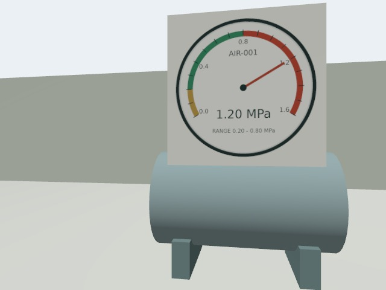

# 异常处理闭环

入口：/alerts。运行总览展示待处理数，检测记录可跳转对应告警。系统已接入登录和角色权限，处理人由服务端登录身份绑定，见 [访问控制](access-control.md)。

## 处理流程

异常、无法判读及设备图像采集/检测失败，均进入设备观察点的待处理事项。一个观察点只保留一个活跃告警；持续出现的问题合并发现次数，同时追加来源任务和处理时间线。已关闭后再次发现会产生新告警。旧的区域级结果缺少设备快照，不自动生成设备告警；升级不回填历史结果。

状态为：待确认 → 处理中 → 待复检 → 复检中 → 复检通过。确认、处理和误报必须填写说明；误报单独留存，不删除原始图片或修改机器判定。可补充处理记录，关闭后不可继续修改历史。

复检复用原告警检查规则，使用当前有效观察点坐标与朝向。创建复检时校验在线状态、续航与机器人占用。告警状态、复检关联、任务和 MQTT outbox 在同一事务提交。重复点击返回已有复检任务。复检失败或取消后允许重新处理、再次复检。

## 关闭条件

普通巡检正常不会关闭历史告警。仅关联复检任务成功完成、冻结的全部检查项均正常，且复检期间没有新增异常，才自动关闭。图像判定早于任务完成时先等待 task_done；后台每秒检查可结束的复检。缺项、无法读取、检测失败、新异常及任务取消/失败均不能关闭。

结果落库和告警更新处于同一事务，(task_no, point_seq) 唯一消费记录防止重复分类覆盖人工处置。同一观察点通过数据库行锁串行化并发发现和处理操作。接口没有“强制关闭”入口。

## API

- GET /api/alerts?status=active：待处理列表，可按 equipment_id 过滤。
- GET /api/alerts/summary：完整状态计数。
- GET /api/alerts/{id}：证据、事件和关联复检。
- POST /api/alerts/{id}/actions：action 为 confirm / false_positive / resolve / note，note 必填。
- POST /api/alerts/{id}/recheck：robot_id 默认为 robot1。

数据库增量迁移：004_alerts.sql。启动时自动建表，不删除原任务和结果。

## 验证

57 项隔离 MySQL 后端测试通过，覆盖并发合并、重复输入、误报后新告警、处理状态、复检幂等、冻结规则、离线/占用回滚、缺项、期间新异常、取消/失败任务和任务完成前的正常照片。

生产前端构建通过（仍有现有大包体积提示）。浏览器在独立数据库、FastAPI 和构建后前端上完成确认、记录处理、发起复检和自动关闭；该轮复检结果为测试注入，并未执行真实机器人。记录见 [浏览器验收](validation/alerts-ui-acceptance.json)。实际仿真运行另记，不能将注入的结果视为视觉准确率证据。

视觉分析已升级为数据库持久任务，支持重启接回、有限重试和结果原子提交，见 [视觉分析恢复说明](vision-recovery.md)。身份认证、角色权限及服务端操作人绑定已实现；对外部署仍需配置 HTTPS、允许来源和独立服务凭证。

### 实际仿真闭环验收

主仿真 robot1 经 Nav2 到达压力表，Gazebo 相机实际拍到 1.20 MPa，VLM 读取并由服务端阈值判异常，自动生成告警。通过浏览器完成确认、记录处理和发起复检；切换可见场景为 0.45 MPa 后，机器人再次拍照，判定正常且任务 DONE，告警自动关闭。没有向检测器注入状态答案。详见 [实际验收记录](validation/alerts-live-acceptance.json)。

准备期间原演示电量已耗尽，一条任务未下发并取消；重启空闲仿真后完成两条实际验收任务，原 27 条任务保留。该轮只验证一个压力表场景，不能代表现场识别准确率。

| 异常巡检 | 处理后复检 |
| --- | --- |
|  |  |
