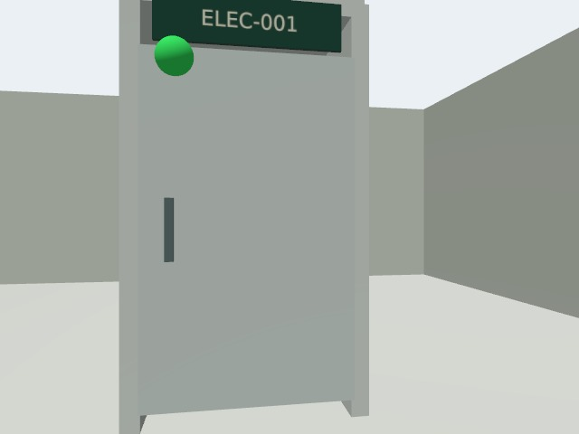
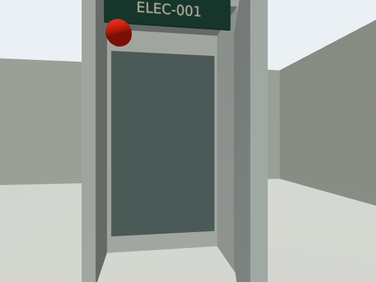
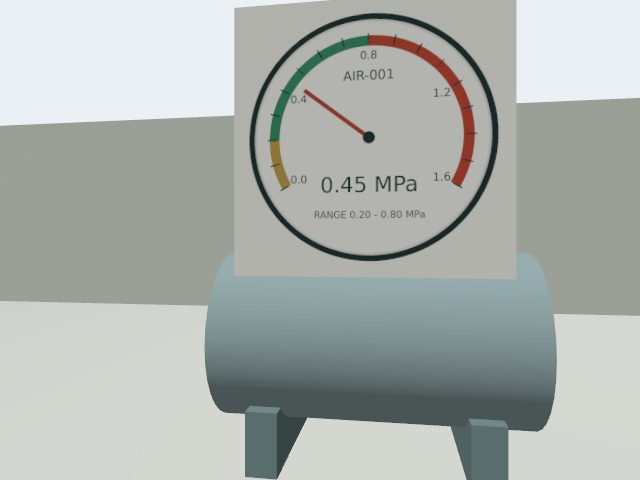
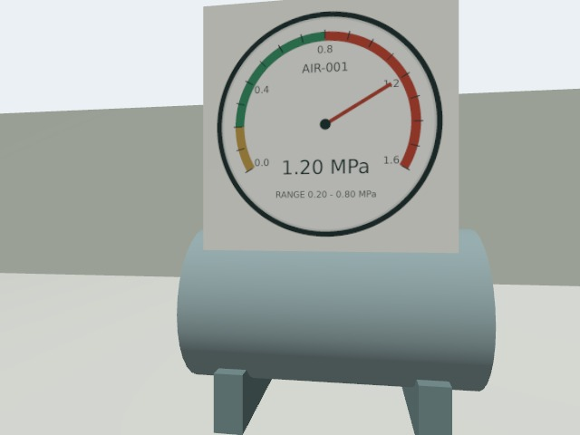
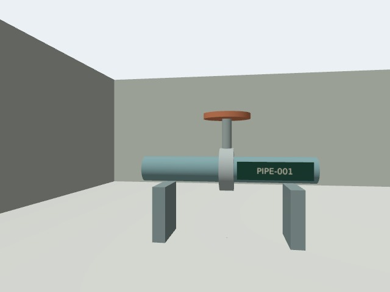
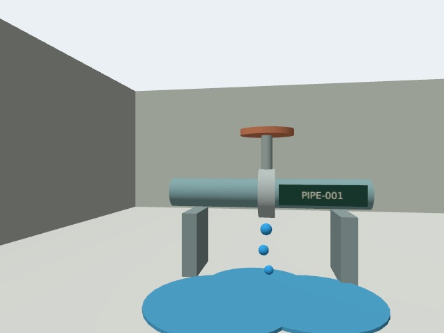

# 设备级巡检（2026-11-09）

车间是区域，设备是巡检对象，观察点决定机器人停车位置和朝向，检查项定义识别规则。当前车间包含 ELEC-001 控制柜、AIR-001 空压机压力表、PIPE-001 管路阀组。每台设备有独立观察点和真实 Gazebo 相机图像。

## 使用

打开 /equipment 查看台账，点击安排巡检会填入指令，确认发送后创建任务。也可说“巡检车间所有设备”或“检查 AIR-001”。车间区域会展开为三个设备观察点；任务详情、结果筛选和 CSV 都带设备信息。

设备、观察点与检查项由 shared/equipment_catalog.json 提供初始种子。迁移 003 建表，启动时 INSERT IGNORE 保留已有台账。修改种子不会覆盖数据库现有值；调整部署位置时须同步数据库观察点、机器人配置和仿真地图。当前不提供台账编辑界面。

任务创建时冻结设备名称、观察点、朝向和检查规则；重试与历史结果沿用快照。机器人回传不能覆盖服务端快照。幂等重试按原始请求意图匹配，即使设备之后停用也返回原任务。

## 仿真与判定

模型由 scripts/gen_nav2_factory.py 和 equipment_models.py 生成，需要 python3-pil。主启动脚本会生成模型并构建工作区。状态切换仅改变可见场景，不向视觉模型提供状态答案：

~~~bash
source /opt/ros/jazzy/setup.bash
source robot_ws/install/setup.bash
GZ_PARTITION=inspection_factory python3 scripts/set_equipment_state.py all abnormal
GZ_PARTITION=inspection_factory python3 scripts/set_equipment_state.py all normal
~~~

控制柜切换绿灯/红灯及柜门姿态；压力表切换 0.45 / 1.20 MPa；管路切换干燥/液滴及积液。压力范围 0.2–0.8 MPa 由服务端根据识别数值判断。单位错误、无法读取或检查项缺失标为需复核，不算正常。设备图标是结构示意，不代表实时状态。

## 验证及边界

40 项后端测试和 9 项 ROS 组件测试通过；前端生产构建通过，有现有的大包体积提示。隔离 ROS_DOMAIN_ID=215、MQTT 18886 的实际 Nav2/Gazebo 流程完成两次三设备任务，6 张图均来自相机，正常组全部正常，异常组全部检出。记录见 [最终验收](validation/equipment-acceptance.json)。这只是六张合成场景样本，不能作为工业现场准确率。

首轮管路积液因视野裁切和形状不清未检出，见 [首轮记录](validation/equipment-first-pass-missed-leak.json)。后续调整观察距离和积液几何，再次真实运行通过。柜门开启检查仍出现漏检，控制柜异常由红灯检出，因此不能宣称柜门检测已可靠。

| 设备 | 正常 | 异常 |
| --- | --- | --- |
| 控制柜 |  |  |
| 压力表 |  |  |
| 管路 |  |  |

复测入口：backend/scripts/equipment_acceptance.py --vlm。需先启动同域、同分区、robot_id=equipmenttest、mqtt_port=18886 的隔离 Nav2 场景；脚本创建并删除自己的测试数据库，保留相机图与报告。测试结束恢复正常场景。实际部署仍需现场标定、多光照与遮挡样本、误报漏报评估和人工复核流程。
